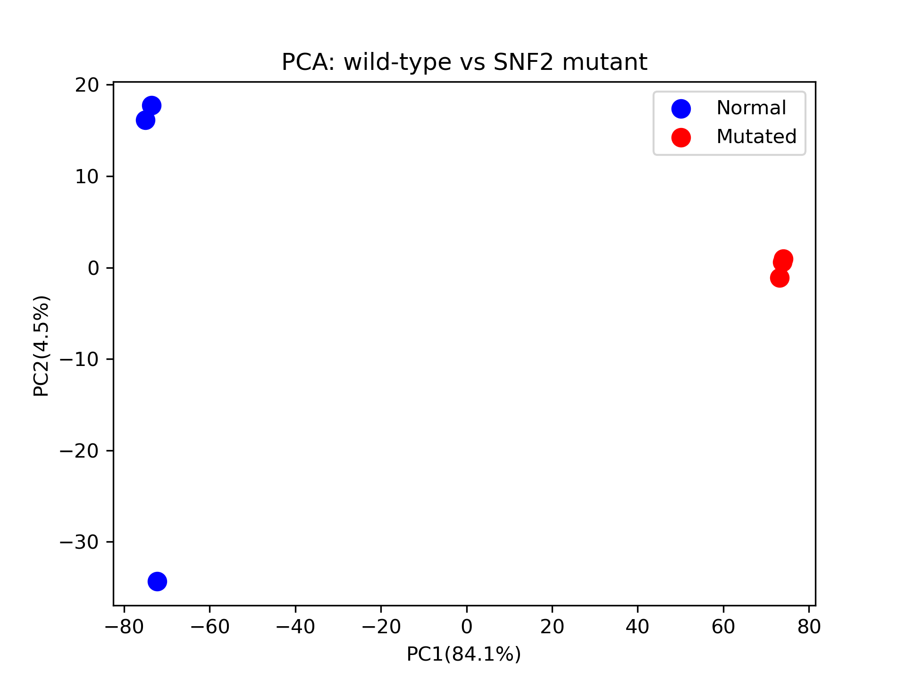
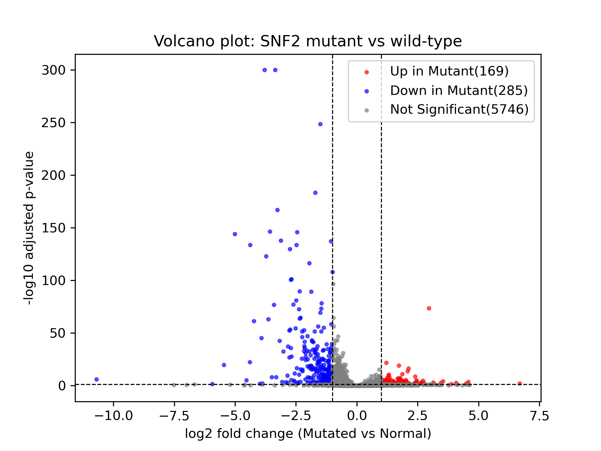
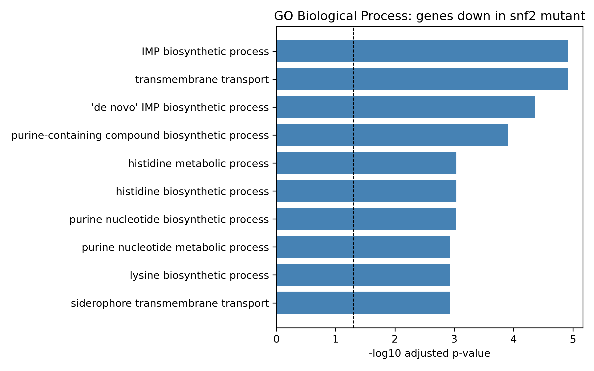

# Yeast RNA-seq Pipeline: Salmon Quantification and PyDESeq2 Analysis

An end-to-end RNA-seq differential expression pipeline, from raw sequencing reads to annotated results, comparing wild-type *Saccharomyces cerevisiae* with an *snf2* deletion mutant.

This was a learning project: the aim was to build and understand each step of a bulk RNA-seq workflow myself, starting from raw FASTQ files rather than a pre-made count matrix.

---

## Dataset

- **Study:** Schurch et al. (2016), *RNA* 22(6):839–851, ENA project **PRJEB5348**
- **Organism:** *Saccharomyces cerevisiae* (strain S288C background, reference assembly R64-1-1)
- **Original study purpose:** to determine how many biological replicates an RNA-seq experiment needs, and which differential expression tools perform best. The authors sequenced 48 replicates each of wild-type and *snf2* mutant yeast.
- **Subset used here:** 3 wild-type and 3 *snf2* mutant samples (single-end reads)

| Accession | Group |
|---|---|
| ERR458493 | Wild-type (Normal) |
| ERR458494 | Wild-type (Normal) |
| ERR458495 | Wild-type (Normal) |
| ERR458500 | *snf2* mutant (Mutated) |
| ERR458501 | *snf2* mutant (Mutated) |
| ERR458502 | *snf2* mutant (Mutated) |

Group labels were assigned from the study design and confirmed in the data: the three mutant samples have no reads for *SNF2* (YOR290C), while the wild-type samples have 125–143.

**About SNF2:** SNF2 ("Sucrose Non-Fermenting 2") is the catalytic subunit of the SWI/SNF chromatin remodelling complex, which helps activate gene transcription by making DNA accessible.

---

## Pipeline

```
Ensembl yeast transcriptome (cDNA FASTA)
        │
        ▼
salmon index ──────────────► transcriptome index
                                   │
ENA FASTQ reads (6 samples) ───────┤
                                   ▼
                     salmon quant (per sample)
                                   │
                                   ▼
              salmon quantmerge (-c numreads) ──► count matrix
                                   │
                                   ▼
        Python: PyDESeq2 · PCA · volcano plot · gene annotation
```

1. **Download** the yeast reference transcriptome (Ensembl cDNA) and raw reads (ENA)
2. **Index** the transcriptome with Salmon
3. **Quantify** each sample with `salmon quant` (selective alignment, automatic library type detection)
4. **Merge** per-sample estimated read counts into one matrix with `salmon quantmerge -c numreads`
5. **Analyse** in Python:
   - round estimated counts to integers (required by PyDESeq2)
   - differential expression with PyDESeq2 (`design = ~group`, contrast Mutated vs Normal)
   - PCA on log2-transformed, standardised counts
   - volcano plot
   - gene annotation parsed from the Ensembl FASTA headers (gene symbol and description)

---

## Repository structure

```
yeast-rnaseq-pipeline/
├── script/
│   ├── run_pipeline.sh            # whole pipeline: download → index → quant → merge → analysis
│   ├── yeast-rnaseq-pipeline.py   # differential expression analysis (called by run_pipeline.sh)
│   └── yeast_dge.ipynb            # exploratory notebook version of the analysis
├── data/
│   └── processed/
│       └── combined_matrix.tsv    # merged count matrix (raw data and index are not stored)
└── results/
    ├── dge_all_genes.csv
    ├── dge_significant_genes_annotated.csv
    ├── pca_plot.png
    └── volcano_plot.png
```

Raw FASTQ files, the Salmon index and per-sample Salmon output are excluded (see `.gitignore`) because they are large and are regenerated by the pipeline script.

---

## How to run

### Requirements

- Salmon (tested with 2.7.0, installed from bioconda)
- Python 3.10 with `pandas`, `numpy`, `pydeseq2`, `scikit-learn`, `matplotlib`
- `wget`

Example setup with conda:

```bash
conda install -c bioconda salmon
pip install pandas numpy pydeseq2 scikit-learn matplotlib
```

### Run

From the project root folder:

```bash
bash script/run_pipeline.sh
```

The script skips any step whose output already exists, so it can be re-run safely. A full first run downloads about 500 MB of data.

---

## Results

- **Salmon mapping rates:** 83.5–86.1% across all six samples
- **Genes tested:** 6,200 (after PyDESeq2 independent filtering)
- **Significant genes** (adjusted p < 0.05 and |log2 fold change| > 1): **454**
  - **285 decreased** in the *snf2* mutant
  - **169 increased** in the *snf2* mutant

### PCA



PC1 explains 84.1% of the variance and completely separates wild-type from mutant samples. PC2 (4.5%) reflects minor variation between wild-type replicates.

### Volcano plot



### Top genes

| Direction | Gene | Function (from SGD) | log2FC |
|---|---|---|---|
| Down | SED1 | stress-induced cell wall glycoprotein | −3.80 |
| Down | HXT7 | high-affinity glucose transporter | −3.36 |
| Down | ENO2 | enolase (glycolysis) | −1.51 |
| Down | CDC19 | pyruvate kinase (glycolysis) | −1.71 |
| Down | GSY1 | glycogen synthase | −3.26 |
| Up | SER3 | serine and glycine biosynthesis | +2.96 |
| Up | CIT2 | citrate synthase, glyoxylate cycle | +2.12 |
| Up | GAP1 | general amino acid permease | +1.31 |
| Up | ADR1 | transcription factor for non-glucose carbon use | +1.24 |
| Up | SWI1 | SWI/SNF complex subunit | +1.70 |

Full tables: `results/dge_significant_genes_annotated.csv` (454 genes) and `results/dge_all_genes.csv` (all tested genes).

---

## Interpretation

SNF2 is part of the SWI/SNF complex, which helps switch genes on by opening up chromatin. Consistent with this, more genes decreased (285) than increased (169) in the *snf2* mutant. The most strongly decreased genes were involved in glucose uptake and use, including the glucose transporter HXT7, the glycolytic enzymes ENO2 and CDC19, and glycogen synthase GSY1. Increased genes included those for alternative carbon use (ADR1, CIT2), amino acid uptake and synthesis (GAP1, PUT4, SER3), and another SWI/SNF subunit, SWI1, which may reflect compensation. These results suggest that loss of SNF2 impairs the normal sugar-handling programme, though expression data alone cannot distinguish direct effects of SNF2 from downstream effects.

---

## GO enrichment analysis

To find which biological processes were affected, I ran GO over-representation
analysis with gseapy (`GO_Biological_Process_2018` library). Down- and
up-regulated genes were tested separately, using all 6,200 tested genes as the
background.

**Genes decreased in the snf2 mutant (285)** were enriched for four themes:

- purine (IMP) biosynthesis: ADE1, ADE2, ADE4, ADE6, ADE13, ADE17 (7 of the 10 genes in the pathway)
- histidine biosynthesis: HIS1, HIS3, HIS4, HIS6, HIS7
- lysine biosynthesis: LYS1, LYS2, LYS9, LYS12, LYS20
- transmembrane transport, including glucose (HXT6, HXT7) and iron (ARN1, ARN2, SIT1) transporters

Glycolysis was also enriched (6 of 19 genes, padj = 0.0045).



**Genes increased in the snf2 mutant (169)** showed no significantly enriched
processes (all padj > 0.05). The up-regulated genes are spread across many
different processes, with only one or two genes in each. This fits SWI/SNF's
main role in activating genes: losing it lowers whole programmes together,
while the increases look more like scattered, indirect effects.

**Limitations**

- The GO library is from 2018, so newer gene annotations are not included.
- About 1,600 of the 6,200 tested genes have no Biological Process annotation
  and could not contribute to any term.
- Several enriched terms overlap because GO terms are nested (for example, the
  IMP and purine terms share the same ADE genes), so they are grouped into
  themes above.

## Notes and limitations

- **Small sample size:** 3 replicates per group (the original study had 48). Results are robust for strong effects but may miss subtler changes.
- **Dispersion trend:** PyDESeq2 reported that the parametric dispersion trend did not converge and switched to a mean-based trend. This is common with few replicates.
- **Rounded counts:** Salmon's estimated counts can be fractional; they were rounded to integers before PyDESeq2.
- **Reference version:** the pipeline downloads from Ensembl's `current_fasta` folder, which always points to the latest release. Results may differ slightly if run against a newer release.
- **Interpretation is exploratory:** themes were identified by reading the top-ranked genes. A gene set enrichment analysis would test them statistically.

---

## Possible next steps

- Gene set / GO enrichment analysis on the 454 significant genes
- Include more of the 48 available replicates
- Rebuild the pipeline with a workflow manager (e.g. Nextflow) for parallel, resumable runs
